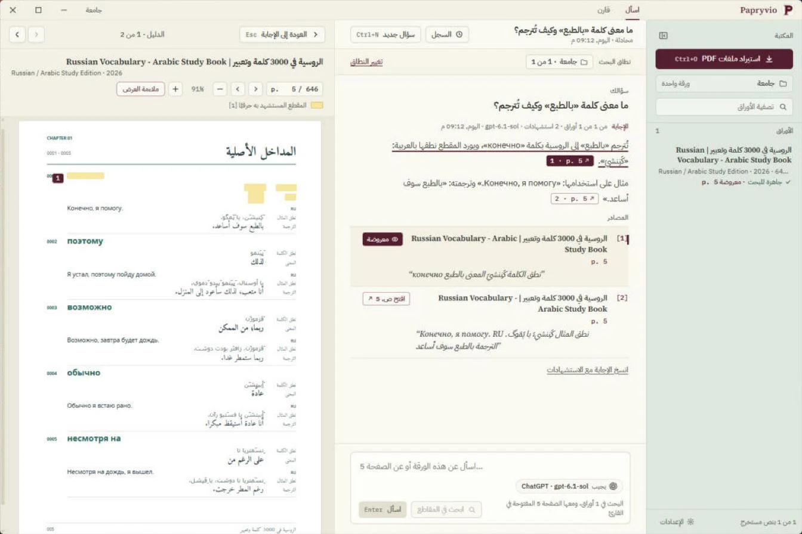
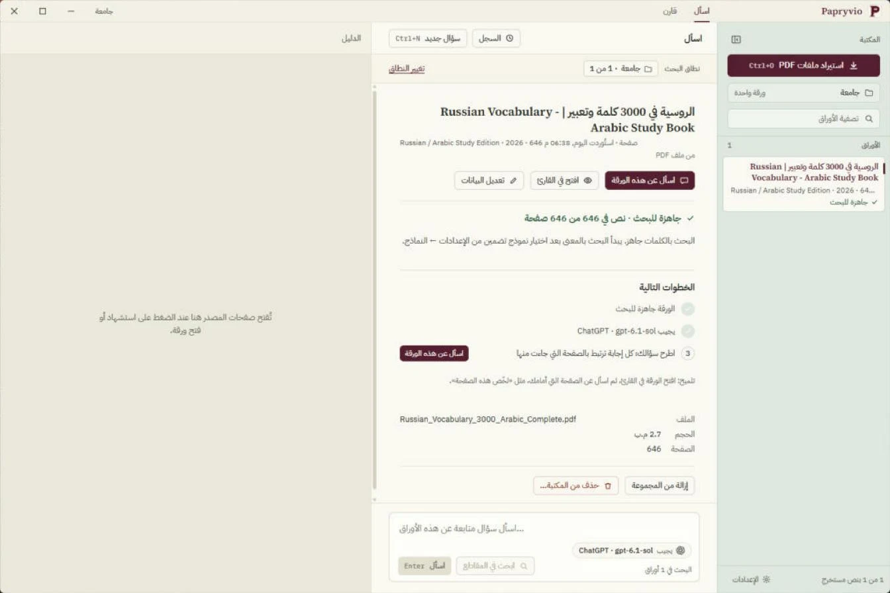
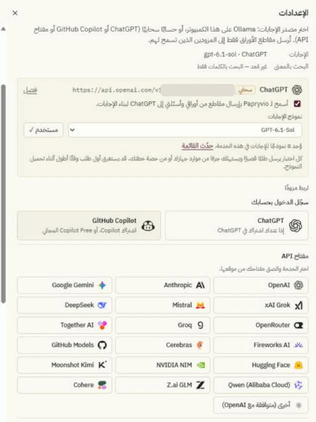

<div align="center">


#  Papryvio · بابريفيو
### An Arabic-first research workspace for your PDF papers — every answer links back to its page

[](https://github.com/AhmadALSaffan/Papryvio/actions/workflows/ci.yml)
[](https://tauri.app/)
[](https://www.rust-lang.org/)
[](https://react.dev/)
[](https://www.typescriptlang.org/)
[](https://www.sqlite.org/fts5.html)
[](https://pdfium.googlesource.com/pdfium/)
[](#-getting-started)
[](#overview)
[](#)

---
</div>

## Overview

**Papryvio** is a Windows desktop app developed by [AhmadALSaffan](https://github.com/AhmadALSaffan) for reading and researching PDF papers. You import your papers, and Papryvio extracts and indexes them on your own machine. Then you ask questions in Arabic or English: the answer comes **only from your papers**, every claim carries a citation, and one click opens the original page with the quoted passage highlighted. You can also compare two papers aspect by aspect — method, data, metric, result, limitations — with evidence in every cell.

The whole interface is Arabic and right-to-left from the ground up (English is one click away), the library and index stay on your computer, and no paper text leaves it without your explicit consent per provider.

> 🔑 **Bring your own model:** Papryvio has no account and no cloud of its own. Sign in with a ChatGPT (Plus or Pro) or GitHub Copilot account, add an API key for the provider you choose (stored in Windows Credential Manager), or run a model locally with Ollama. Finding passages works with no model at all.

---

## Screenshots

<div align="center">

| An answer, and its source | One paper, start to finish |
|:---:|:---:|
|  |  |
| Ask in Arabic; every claim cites a page. Click a citation and the original page opens beside the answer with the passage highlighted — `[` and `]` step through the sources, `Esc` goes back. | Whether the paper is ready to search, which model will answer, and what to do next — with *Ask about this paper* one click away. |

| Models | |
|:---:|:---:|
|  | |
| Sign in with ChatGPT or GitHub Copilot, paste a key for one of 18 providers, or connect Ollama and LiteLLM on your own machine. Every model is tested with a real request before it's used. | |

<sub>Screenshots of Papryvio 0.1 in Arabic; the app has an English interface too.</sub>

</div>

---

## Features

- 📥 **Import PDFs** — Pick files or drop them on the window. Papryvio checks the real file type and size, hashes it (SHA-256) so the same paper is never imported twice, and copies it into its own library
- 🧱 **A PDF engine in its own process** — Text extraction runs PDFium in a separate worker with a time limit, so a broken PDF can't take the app down. Scanned papers are flagged as *needs OCR* and password-protected ones are reported
- 🔤 **Arabic that reads right** — Some PDFs store Arabic letters in visual order, so they extract backwards (“ةيلصألا” instead of “الأصلية”). Papryvio detects this and repairs the text before indexing
- 🔎 **Keyword, meaning, or both** — SQLite FTS5 with BM25 over a normalized copy of every chunk (hamza forms, ta marbuta, harakat and «ال»/«بال»/«لل» folded the way people write), vector search with any embedding model, and a hybrid of the two (Reciprocal Rank Fusion)
- 💬 **Answers only from your papers** — Up to 10 passages go to the model as data, never as instructions. Each claim has to cite them; citations outside the evidence are dropped, quotes are checked against the source, and numbers missing from their passages are flagged. The result is *answered*, *partial*, or an honest *no evidence*
- 📄 **Ask about the page in front of you** — With a paper open in the reader, the current page goes along with the question, so “summarise this page” or “what words are on this page?” just works
- 🖍️ **Open the source** — A citation opens the original page in the built-in pdf.js reader with the quoted span highlighted from PDFium's own coordinates (rotation-aware)
- ⚖️ **Compare two papers** — Default aspects or your own; every cell is retrieved and answered separately, with its own status and sources. Export to Markdown or CSV
- 🗂️ **Collections** — Group papers and scope a question to a collection or to the papers you pick; Papryvio says which papers were searched and which weren't (and why)
- ⏯️ **Jobs that survive a restart** — Extract → index → embed run as persisted jobs with checkpoints: pause, resume, cancel, retry, and pick up where they stopped after the app closes
- 🧠 **Any model** — ChatGPT (official sign-in), GitHub Copilot (device sign-in + the official Copilot SDK), OpenAI, Anthropic, Google Gemini, xAI Grok, Mistral, DeepSeek, OpenRouter, Groq, Together AI, Fireworks AI, Cerebras, GitHub Models, Hugging Face, NVIDIA NIM, Moonshot Kimi, Qwen, Z.ai GLM, Cohere, any OpenAI-compatible server, Ollama and LiteLLM. Model lists are fetched from the service, so you only pick from a list
- ↔️ **A layout you size yourself** — Drag the lines between the library, the answer and the reader (double-click to reset); sizes are remembered. Narrow windows slide the reader over the answer instead of squeezing it. `Ctrl+B` and `Ctrl+J` show or hide the library and the reader
- 🔍 **Interface size** — `Ctrl` `+` / `−` / `0`, or Settings → Interface, from 80% to 150%
- ⚡ **One-click questions about the open page** — *Summarize this page*, *Explain this page simply*, *What are the key terms on this page?*
- ⌨️ **Every shortcut in one list** — `Ctrl+/` or `F1`, and Arabic keyboard layouts work with every shortcut
- 👀 **Always know who answers** — The question box shows the model that will answer (`ChatGPT · gpt-…`); click it to change
- 🧭 **A guide and next steps** — A five-step welcome (language, model, first collection, first paper, first question) and a *Next steps* list on each paper
- 💾 **Conversations kept** — Every question, attempt, evidence bundle and citation is saved; retry an answer or cancel one mid-stream
- 📏 **Evaluation built in** — `papryvio-eval` measures retrieval (Hit@k, Recall@k, MRR) and checks answers against a JSONL dataset
- 🔐 **Local-first** — The library, index and conversations live in SQLite on your machine; keys and sign-in tokens go to Windows Credential Manager, never into the database
- 🌐 **Arabic and English** — Arabic-first and right-to-left, with a full English interface (left-to-right) switchable from Settings

---

## Tech Stack

| Layer | Technology |
|---|---|
| Desktop shell | Tauri 2 (Rust) |
| UI | React 19 · TypeScript 5 (strict) · Vite · Zustand |
| Core | Rust — Clean / Hexagonal layers (domain · application · infrastructure · desktop) |
| PDF | PDFium (`pdfium-render`) in a separate worker process · pdf.js reader |
| Search | SQLite FTS5 + BM25 · float32 vectors · Reciprocal Rank Fusion |
| Database | SQLite via `rusqlite` (bundled, WAL) with numbered migrations |
| Models | Ollama · OpenAI-compatible · Anthropic · ChatGPT (Responses API) · GitHub Copilot SDK |
| Secrets | `keyring` → Windows Credential Manager |
| Contracts | `ts-rs` generates the TypeScript IPC types from Rust |
| Packaging | NSIS installer (Tauri bundler) |
| Quality | `cargo test` · Vitest · `tsc --noEmit` |

---

## 🚀 Getting Started

### Prerequisites

- Windows 10 or 11 (x64) with WebView2 (ships with Windows 11)
- A ChatGPT or GitHub Copilot account, an API key for one supported provider — or [Ollama](https://ollama.com/) running locally

For building from source you also need:

- [Node.js](https://nodejs.org/) 20+
- [Rust](https://rustup.rs/) stable (1.94+) with Visual Studio Build Tools (*Desktop development with C++*)

### 1 — Clone the Repository

```bash
git clone https://github.com/AhmadALSaffan/Papryvio.git
cd Papryvio
npm install
```

### 2 — Fetch PDFium

```bash
npm run setup:pdfium
```

Downloads PDFium `chromium/8125` (SHA-256 pinned) into `src-tauri/resources/pdfium`.

### 3 — Run

```bash
npx tauri dev
```

### 4 — Use it

1. **Import** — *Import PDFs* (`Ctrl+O`) or drop files on the window. Wait for *Ready to search*.
2. **Pick a model** — Settings → Models: sign in with ChatGPT or Copilot, paste an API key, or connect Ollama (`ollama pull qwen3:4b` and `ollama pull nomic-embed-text`, then `http://127.0.0.1:11434`). Cloud providers get paper passages only after you tick their consent box.
3. **Ask** — Type a question and press `Enter`. Click a citation to open its page; `[` / `]` move between sources and `Esc` returns to the answer.
4. **Compare** — The *Compare* tab: choose two papers and the aspects to compare.

Without an embedding model search is keyword-only; *Find passages* works without any model.

### 5 — Test

```bash
cd src-tauri && cargo test --lib     # domain, SQLite/FTS5, pipeline, recovery, PDFium, RAG, comparison
npm test && npm run typecheck        # frontend
npm run gen:types                    # regenerate TS contracts from Rust (ts-rs)
```

### 6 — Build the Installer

```bash
npx tauri build
```

The NSIS installer is written to `src-tauri/target/release/bundle/nsis`.

---

## Configuration

Papryvio works without any configuration. Everything is set from **Settings** inside the app: language, answer language, models, and the per-provider consent for sending passages.

```env
PAPRYVIO_GITHUB_CLIENT_ID=   # build time: the GitHub OAuth App used for Copilot sign-in — set this in a fork
```

### Where your data lives

| What | Where |
|---|---|
| Library, index, conversations, settings | `%APPDATA%\com.papryvio.desktop\papryvio.db` |
| Imported PDFs | `%APPDATA%\com.papryvio.desktop\library` |
| Imports in progress | `%APPDATA%\com.papryvio.desktop\staging` |
| Exports (Markdown, CSV) | `%APPDATA%\com.papryvio.desktop\exports` |
| Logs | `%APPDATA%\com.papryvio.desktop\logs` |
| Copilot sign-in data | `%APPDATA%\com.papryvio.desktop\copilot` |
| API keys and sign-in tokens | Windows Credential Manager |

Delete the folder for a clean start.

---

## Architecture

```text
┌──────────────────────────── Papryvio.exe (Tauri 2 · Rust) ─────────────────────────────┐
│  React UI (RTL)  ──invoke / events──►  desktop (commands, IPC DTOs, events)            │
│                                              │                                         │
│                                              ▼                                         │
│                              application (use cases + ports)                           │
│                                 │                        │                             │
│                                 ▼                        ▼                             │
│                           domain rules          infrastructure adapters                │
│                                       SQLite + FTS5 · file store · OS credential store │
└───────────────────────────────────────────────────────┬────────────────────────────────┘
                                                        │
              papryvio.exe --pdf-worker (PDFium) ◄──────┤  JSON lines over stdin/stdout
              the model you chose (or local Ollama) ◄───┘  only with your consent
```

**A question, step by step:** resolve the scope → keyword + meaning retrieval (fused with RRF) → an evidence bundle of up to 10 passages, saved per attempt → a versioned prompt that treats passages as data → JSON claims validated against the evidence (citations, quotes, numbers) → citations that open the exact span on the page.

### Project Structure

```text
Papryvio/
├── src/                                  # React 19 · TypeScript (Arabic-first, RTL)
│   ├── main.tsx
│   ├── app/                              # App shell, title bar, dialogs, shortcuts, stores (library + RAG)
│   ├── features/
│   │   ├── chat/                         #   the question box, conversations, answers with citations
│   │   ├── reader/                       #   pdf.js viewer, evidence pane, highlights
│   │   ├── comparison/                   #   compare two papers, export
│   │   ├── workspace/                    #   overview, paper detail, next steps, job controls
│   │   ├── library/                      #   sidebar: collections and papers
│   │   ├── models/                       #   providers, sign-ins, model lists (catalog.ts)
│   │   ├── settings/                     #   the settings dialog
│   │   └── onboarding/                   #   the five-step welcome
│   ├── shared/                           # design tokens, i18n (ar / en), IPC, generated types, UI kit
│   └── assets/providers/                 # provider logos (licenses in NOTICE.md)
├── src-tauri/                            # Rust core
│   ├── src/
│   │   ├── domain/                       #   chunking, retrieval, evidence checks, Arabic text repair
│   │   ├── application/                  #   ingestion, indexing, retrieval, answering, comparison, models, jobs
│   │   ├── infrastructure/
│   │   │   ├── sqlite/                   #     repositories, FTS5 index, migrations, tests
│   │   │   ├── pdf/                      #     worker process client, protocol, PDFium extraction
│   │   │   ├── models/                   #     Ollama, OpenAI-compatible, Anthropic, ChatGPT, Copilot
│   │   │   ├── auth/ · filesystem/
│   │   ├── desktop/                      #   Tauri commands and events
│   │   ├── bin/papryvio-eval.rs          #   retrieval and answer evaluation
│   │   └── bootstrap.rs                  #   composition root — the only place that knows the adapters
│   ├── migrations/                       # 0001_init.sql · 0002_models_index_answers.sql
│   ├── tests/fixtures/                   # small PDFs for the extraction tests
│   └── icons/
├── scripts/                              # fetch-pdfium.mjs · copy-pdf-assets.mjs
├── evaluation/                           # datasets and reports for papryvio-eval
└── docs/                                 # architecture.md · phases.md · evaluation.md · screenshots
```

For a deeper tour — the flow of a question, the indexing pipeline, providers and persistence — see [docs/architecture.md](docs/architecture.md). The full specification is [research-assistant-rag-plan.md](research-assistant-rag-plan.md).

---

## Contributing

Pull requests are welcome! For major changes, please open an issue first to discuss what you'd like to change.

1. Fork the repo
2. Create your feature branch: `git checkout -b feature/your-feature`
3. Run the checks: `cargo test --lib` in `src-tauri`, `npm test && npm run typecheck` at the root
4. Commit your changes: `git commit -m "feat: add your feature"`
5. Push to the branch: `git push origin feature/your-feature`
6. Open a Pull Request

---

## License

```text
No license has been chosen for Papryvio yet — any help, feedback, or contributions are more than welcome!
```

PDFium is downloaded at build time under its own BSD-style license. Provider logos are listed with their licenses in [src/assets/providers/NOTICE.md](src/assets/providers/NOTICE.md).

---

<div align="center">
  Built with ❤️ by <a href="https://github.com/AhmadALSaffan">Ahmed Eliwi AL Saffan · أحمد عليوي السفان</a>
</div>
