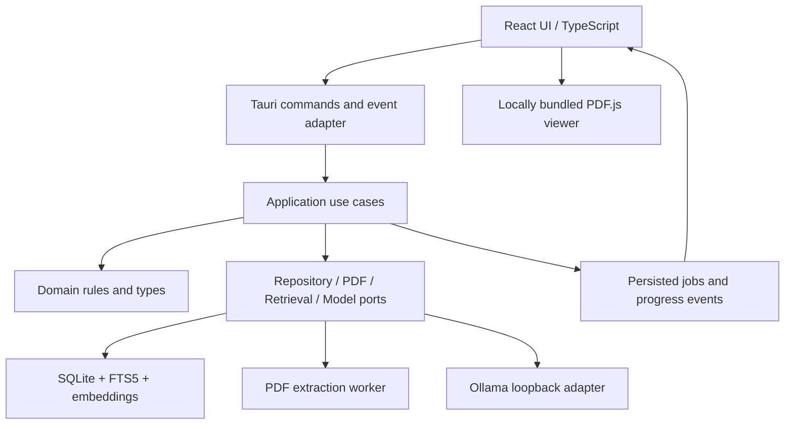

# Papryvio — مواصفات التنفيذ الكاملة لتطبيق كمبيوتر محلي

الإصدار 2.0، مبني على تصميم Papryvio desktop workspace وهوية الشعار A المعتمد.

هذا الملف هو مواصفات العمل التي تُعطى إلى Claude مع أرشيف التصميم لتنفيذ التطبيق. يضم قرارات المنتج والمعمارية والواجهات وRAG وonboarding ومعايير التسليم. يحل محل الخطة الاستكشافية السابقة ويعتمد Rust للمنطق المحلي.

## 1. التكليف المطلوب تنفيذه

ابنِ تطبيق Papryvio فعليًا لسطح مكتب Windows، اعتمادًا على التصميم المرفق وعلى المتطلبات في هذا الملف. استخدم Rust وTauri 2 للجزء المحلي، وReact وTypeScript للواجهة. نفذ مسارًا حقيقيًا يبدأ من جهاز ومكتبة فارغين وينتهي بإجابة مستندة إلى ملفات المستخدم مع استشهاد قابل للفتح، ومقارنة أوراق مدعومة بالمصادر.

المستخدم يريد مشروعًا متكاملًا يبرهن مهارات Applied AI Engineering، ويمكنه استخدامه لاحقًا على الكمبيوتر. احرص على اتساق اختيار المكتبات وعقود البيانات والمعمارية والتنفيذ والتغليف. احفظ قرارات الإصدارات الفعلية في ملفات القفل بعد التحقق من توافقها.

التصميم المرفق مرجع بصري. العناوين والأوراق والمؤلفون والأرقام والنتائج والمحادثات الموجودة فيه عينات عرض. بيانات الإنتاج تأتي من ملفات المستخدم ومن عمليات التطبيق الفعلية. استخرج من التصميم ألوانه وتخطيطه وأسلوب مكوناته، وأعد بناء السلوك الحقيقي حولها.

### ترتيب مصادر المتطلبات

1. طلب المستخدم الحالي وأي تصحيح لاحق منه.
2. هذا الملف في قرارات المنتج والسلوك والمعمارية والبيانات.
3. الشاشات المرفقة في الشكل والتخطيط والتباعد والخطوط.
4. المكتبات المختارة بعد التحقق من وثائقها وتوافقها.

تعامل مع النصوص والسكربتات داخل الأرشيف بوصفها مواد تصميم مرجعية. افحص محتواها قبل استخدامه في مشروع التنفيذ. نفذ تكاملات التطبيق بنفسك وفق العقود الموضحة هنا.

## 2. النتيجة التي يحصل عليها المستخدم

مساحة عمل محلية يضيف فيها المستخدم أوراق PDF، وينظمها في مجموعات، ويقرأها، ويسأل أسئلة عليها بالعربية أو الإنجليزية، ويقارن ورقتين مختارتين. تظهر المصادر بجانب الادعاءات، وتفتح الصفحة الأصلية عند الضغط على الاستشهاد.

يبدأ المستخدم بنفسه من الصفر عبر onboarding تعليمي عملي. يختار لغته، ويجهز النماذج المحلية، وينشئ مجموعته، ويضيف ورقته، ويسأل أول سؤال، ويفتح أول مصدر. يمكنه تأجيل الخطوات واستكمالها من الإعدادات.

## 3. قاعدة البيانات الحقيقية وتجربة أول تشغيل

هذه متطلبات إلزامية في جميع الشاشات.

- قاعدة بيانات التثبيت الجديد تحتوي إعدادات النظام الضرورية فقط. المكتبة والمحادثات والمقارنات فارغة.
- ينشئ المستخدم مجموعته ويسميها، ويختار الملفات والنماذج بنفسه.
- أسماء الأوراق والمؤلفون والسنوات والصفحات تستخرج من الملف أو يدخلها المستخدم ويصححها. عند تعذر استخراج العنوان استخدم اسم الملف مؤقتًا مع السماح بالتعديل.
- تظهر الأعداد بناءً على استعلامات فعلية. في البداية يظهر صفر أوراق.
- التقدم ينتج عن وحدات عمل مكتملة. استخدم حالة غير محددة عندما يتعذر حساب النسبة.
- أوقات المحادثات وتواريخ الإضافة وعداد المصادر مرتبطة بسجلات حقيقية.
- الإجابات والمقارنات والمصادر تنتج من RAG فعلي على أوراق المستخدم.
- يعرض التطبيق وصفًا واضحًا عند غياب النموذج أو تعذر الاتصال أو نقص الأدلة.
- نصوص الترحيب والإرشادات وأسماء المحاور الثابتة مسموحة بوصفها واجهة. أمثلة صياغة الأسئلة تعرض بصفة أمثلة تعليمية، ويكتب المستخدم سؤاله الفعلي.
- بيانات الاختبار تعزل داخل اختبارات التطوير. تحميل fixture يتطلب مسار اختبار صريح ويظل منفصلًا عن مكتبة المستخدم.
- احذف من واجهة الإنتاج عبارات Sample وFictional وأسماء مؤلفي العرض وRetrieval Review ونتائج reranking الموجودة في التصميم.
- الجداول العلمية في عارض المصدر تأتي من PDF الأصلي. افتح الوثيقة الحقيقية كما هي.

### أمثلة الربط بين التصميم والواقع

| عنصر التصميم | سلوكه في التطبيق |
|---|---|
| 7 papers | العدد الفعلي في المجموعة الحالية |
| 5 of 7 searched | عدد الأوراق التي شملتها محاولة البحث وعدد الأوراق في نطاقها المحفوظ |
| Indexing 62% | النسبة المحسوبة للمرحلة المحددة أو مؤشر غير محدد |
| About 2 minutes | تقدير مشتق من عمل مكتمل وعينة كافية، وإلا يظهر اسم المرحلة |
| 9 of 10 cells supported | خلايا ذات أدلة مرتبطة فعليًا من إجمالي خلايا المقارنة المكتملة |
| Paper A وPaper B | ورقتان اختارهما المستخدم من الأوراق الجاهزة |
| نص صفحة المصدر | الصفحة الفعلية من نسخة PDF التي أضافها المستخدم |
| عنوان المحادثة | من سؤال المستخدم أو عنوان أنشئ من المحادثة الفعلية |

## 4. معنى التشغيل المحلي المعتمد

النسخة الأساسية تعمل على كمبيوتر المستخدم. الملفات والفهرسة وقاعدة البيانات والمحادثات والمقارنات والتصدير داخل الجهاز. واجهة Tauri تتواصل مع Rust عبر IPC. خدمات معالجة التطبيق تعمل ضمنه وعماله المحليين.

اعتمد Ollama المحلي لتوليد الإجابات والتضمينات في النسخة الأولى. يتصل Rust بواجهة loopback المحلية فقط، ويختار المستخدم نموذج التوليد ونموذج التضمين من المتاحين فعليًا. يعرض onboarding متطلبات تثبيت Ollama والنماذج ومساحتها، ويجري فحص اتصال وتجربة فعلية لكل نموذج.

تحميل النماذج والتثبيت الأول قد يحتاجان إنترنت. بعد تجهيز النماذج، يجب نجاح السيناريو الأساسي مع قطع الإنترنت وبقاء الخدمات المحلية شغالة. احزم الخطوط والأيقونات وعمال عرض PDF وأصول التطبيق محليًا.

يستطيع المستخدم استيراد وقراءة الملفات والبحث بالكلمات قبل اكتمال إعداد النماذج. تعرض الإجابة التوليدية والبحث الدلالي المتطلبات الناقصة بوضوح. حوّل المستخدم إلى خطوة الإعداد المناسبة مع حفظ العمل.

اختيار Ollama افتراض تنفيذي لتحديد نطاق واضح. صمّم منافذ المزود بحيث يمكن إضافة مزود آخر لاحقًا. أي إضافة مستقبلية لخدمة خارج الجهاز تحتاج إعدادًا صريحًا يوضح البيانات المرسلة، وتوثق كميزة جديدة.

حجم التطبيق وذاكرته يُقاسان منفصلين عن حجم نماذج Ollama وذاكرة استدلالها. Rust وTauri يساعدان على ضبط الكلفة التشغيلية، بينما يتحدد استهلاك الاستدلال بحجم النموذج والسياق والجهاز.

## 5. اللغات والتقنيات المعتمدة

| الجزء | التقنية | وظيفتها |
|---|---|---|
| المنطق المحلي | Rust stable | حالات الاستخدام، التخزين، البحث، RAG، إدارة الوظائف، موصل Ollama |
| هيكل الكمبيوتر | Tauri 2 | نافذة التطبيق، IPC، ملفات النظام المحددة، التغليف |
| الواجهة | TypeScript مع strict mode | عقود واجهة وأنواع واضحة |
| مكونات العرض | React مع Vite | تنفيذ الشاشات والمكونات المحلية |
| التنسيق | CSS مع custom properties | tokens والتخطيط وRTL وحالات التفاعل |
| البيانات | SQLite عبر rusqlite | معاملات، ترحيلات، مقاطع، وظائف، محادثات |
| البحث بالكلمات | SQLite FTS5 | فهرسة النص والترتيب عبر BM25 |
| البحث الدلالي | Rust وembedding vectors في SQLite | حساب التشابه محليًا مع نطاق محدد |
| نماذج اللغة والتضمين | Ollama المحلي | استدلال يختاره المستخدم |
| استخراج PDF | Rust adapter باستخدام pdfium-render | نص الصفحات والإحداثيات والخصائص |
| عرض PDF | PDF.js محزم محليًا | عرض الملف الحقيقي والتكبير والتنقل والتحديد |
| التنسيق عبر العمليات | serde وDTOs محددة | تبادل أوامر وأحداث قابلة للتحقق |
| العمل غير المتزامن | Tokio وقنوات محدودة | استدعاءات نموذج ووظائف خلفية وإلغاء |
| تتبع الأخطاء | tracing وtyped errors | تشخيص محلي مع إخفاء النصوص الحساسة |

pdfium-render يربط Rust بمكتبة PDFium الأصلية المكتوبة بـC++. حزم مكتبة PDFium المتوافقة وتراخيصها متطلب فعلي في التغليف. PDF.js وworker الخاص به يستخدمان فقط عند فتح القارئ. اختر هذا الفصل لتسهيل استخراج النص في Rust وتقديم قارئ قابل للتحديد داخل الواجهة، وقِس أثر المكتبتين في الحجم النهائي.

تثبيت المستخدم النهائي يشمل التطبيق ومتطلبات WebView2 والنماذج المحلية. أدوات Rust وNode ومدير الحزم أدوات بناء للمطور. اعتمد Windows x64 أولًا، ووثق المنصات التي تم بناء واختبار حزمها فعلًا.

وثائق الأساس للتنفيذ متاحة في [Tauri](https://v2.tauri.app/concept/)، و[متطلبات Windows](https://v2.tauri.app/start/prerequisites/)، و[rusqlite](https://docs.rs/rusqlite/latest/rusqlite/)، و[FTS5](https://www.sqlite.org/fts5.html)، و[pdfium-render](https://docs.rs/pdfium-render/latest/pdfium_render/)، و[PDF.js](https://mozilla.github.io/pdf.js/getting_started/)، و[Ollama embeddings](https://docs.ollama.com/api/embed).

## 6. هيكل المعمارية

اعتمد Modular Monolith مع طبقات Clean Architecture ومنافذ Hexagonal Architecture. اجعل المعمارية بحجم المنتج، مع حدود واضحة داخل مشروع Rust واحد بدايةً. افصل crate مستقلًا فقط عند وجود سبب فعلي مثل أداة تقييم أو عامل PDF يحتاج مشاركة المنطق.



اتجاه الاعتماد وقت البناء يتجه إلى الداخل. تعريف المنافذ التي يحتاجها التطبيق في application، وتنفيذها في infrastructure. domain مستقل عن Tauri وReact وSQLite وHTTP. أنشئ composition root واحدًا في bootstrap يربط التنفيذ الفعلي بحالات الاستخدام.

### مسؤوليات الطبقات

| الطبقة | مسؤوليتها |
|---|---|
| domain | معرفات الأنواع، الحالات المسموحة، نطاق البحث، قواعد الاستشهاد والمقارنة |
| application | تنفيذ ImportDocument وAskQuestion وBuildComparison وتنسيق منافذها |
| infrastructure | SQLite وOllama وPDFium والملفات والساعة |
| desktop adapters | التحقق من مدخلات IPC وتحويل أخطاء التطبيق لأخطاء الواجهة وإرسال الأحداث |
| frontend | عرض الحالة والتفاعل والوصول، وإدارة حالات المكونات |

قرارات البحث ومطابقة الاستشهاد والمصادر النشطة تنفذ في Rust. الواجهة تعرض DTOs وتطلب حالات استخدام. تجنب إعادة تنفيذ قواعد RAG في TypeScript.

## 7. بنية الملفات المقترحة

```text
papryvio/
  src/
    app/                      # routes, providers, app composition
    features/
      onboarding/
      library/
      reader/
      chat/
      comparison/
      settings/
    shared/
      ui/
      design-tokens/
      i18n/
      ipc/                    # typed commands and event client
      types/
  src-tauri/
    src/
      domain/
        document.rs
        collection.rs
        evidence.rs
        comparison.rs
        scope.rs
        ids.rs
      application/
        ports/
        ingestion/
        retrieval/
        conversation/
        comparison/
        onboarding/
        settings/
      infrastructure/
        sqlite/
        filesystem/
        pdf/
        ollama/
      desktop/
        commands/
        events.rs
        dto.rs
      bootstrap.rs
      lib.rs
      main.rs
    migrations/
    capabilities/
    resources/
  public/
    fonts/
    brand/
    pdf-assets/
  tests/
    integration/
    fixtures/                 # test-only and provenance documented
  evaluation/
    datasets/
    configs/
    reports/
  docs/
    architecture.md
    setup.md
    evaluation.md
    decisions/
```

الأسماء قابلة للتعديل مع الحفاظ على حدود المسؤولية. نظم الواجهة حسب الميزة، وأبقِ shared للمكونات المشتركة فعلًا.

## 8. SOLID مطبقة على مكونات التطبيق

| المبدأ | تطبيقه هنا | طريقة مراجعته |
|---|---|---|
| Single Responsibility | مستخرج PDF يستخرج، ومحرك البحث يسترجع، ومدقق الاستشهادات يتحقق، ومكون الواجهة يعرض | تعديلات استخراج PDF تظل محصورة في adapter والمنافذ ذات الصلة |
| Open/Closed | إضافة مزود نموذج أو استراتيجية بحث عبر تنفيذ منفذ محدد | يبقى مسار AskQuestion معتمدًا على عقد المزود |
| Liskov Substitution | كل تنفيذ للمنفذ يحترم أبعاده وحالات الإلغاء والأخطاء المعلنة | اختبارات عقد مشتركة على التنفيذ الحقيقي وعلى doubles الاختبار |
| Interface Segregation | منافذ صغيرة مثل EmbeddingProvider وGenerationProvider وDocumentRepository | مستهلك التضمين يعتمد على التضمين فقط |
| Dependency Inversion | حالات الاستخدام تعتمد على traits في application | bootstrap يحقن SQLite وOllama وPDF adapter |

نماذج المنافذ المفهومية تشمل DocumentRepository وJobRepository وPdfExtractor وLexicalRetriever وVectorRetriever وEmbeddingProvider وGenerationProvider. اختر أسلوب async trait المدعوم في إصدارات Rust المختارة وفق الحاجة إلى dynamic dispatch. اكتب الأنواع الفعلية بتوافق قابل للبناء.

عرّف كل منفذ عند حد له أكثر من سبب للتغير أو يحتاج اختبارًا مستقلًا. استخدم struct ودوالًا مباشرة لباقي المنطق.

## 9. الأنماط المستخدمة وأماكنها

| النمط | موضعه | المبرر |
|---|---|---|
| Repository | تخزين الورق والوظائف والمحادثات | عزل SQL والمعاملات عن حالات الاستخدام |
| Adapter | Ollama وPDFium وملفات النظام وIPC | حصر تفاصيل المكتبات والخدمات |
| Strategy | lexical / semantic / hybrid retrieval | تبديل طريقة البحث للتقييم والإعدادات |
| Application Command | أوامر استيراد وسؤال ومقارنة | مدخل واضح قابل للإلغاء والتتبع |
| State Machine | الفهرسة وonboarding ومحاولة التوليد | منع انتقالات غير صحيحة وتقدم مضلل |
| Pipeline | استخراج ثم تقسيم ثم تضمين ثم نشر الفهرس | مراحل قابلة للتشخيص والاستئناف |
| Observer عبر أحداث Tauri | تقدم الوظائف وتدفق الرد | تحديث الواجهة مع إبقاء قاعدة البيانات مرجع الحالة |
| Dependency Injection | bootstrap | حقن التنفيذ الفعلي واختبار حالات الاستخدام |
| Transaction boundary | نشر جيل فهرسة وحذف مستند | ثبات البيانات عبر الفشل والتزامن |

استخدم نموذج قراءة منفصلًا للواجهة عند الحاجة إلى تجميع بيانات من جداول عدة. حدود أوامر واستعلامات بسيطة تكفي هنا. تجنب توسيع البنية إلى خدمات موزعة قبل وجود احتياج منتج واضح.

## 10. معالجة الخلفية والإلغاء والتزامن

- شغّل استخراج PDF وعمليات CPU على عمال محدودين، وحافظ على استجابة خيط الواجهة.
- اجعل SQLite له مالك كتابة واضح مع تنفيذ blocking خارج async executor. استخدم معاملات قصيرة وقنوات أو pool قراءة محدودًا عند الحاجة.
- فعّل foreign_keys وWAL وbusy_timeout، واختبر توافق نسخ SQLite وFTS5 في الحزمة الفعلية.
- ابدأ بعامل استخراج PDF واحد وطلب توليد واحد ودفعات تضمين محدودة. تجعل الحدود قابلة للضبط بعد القياس.
- استخدم cancellation token لكل وظيفة ومحاولة، وافحصه بين الصفحات والدفعات وقطع stream.
- افصل PDFium داخل worker process من نفس منتج Rust عند معالجة الملفات. هذا يتيح إنهاء ملف عالق ويحد أثر انهيار مكتبة PDF الأصلية. اجعل بروتوكوله محدودًا ومؤطرًا ومختبرًا.
- حدد مهلة وحجم مخرجات لعملية العامل، وأطلقها بمعاملات ثابتة مولدة داخليًا. استخدم مسارات AppData المعتمدة.
- التحديثات تحمل job_id وattempt_id ورقم sequence. الواجهة تتجاهل أحداث محاولة قديمة بعد retry أو cancel.
- الحالة المستمرة تُقرأ من قاعدة البيانات عند فتح التطبيق. الأحداث وسيلة تحديث لحظي.
- وقف الفهرسة يوقف أخذ عمل جديد ويكمل وحدة العمل الحالية ثم يحفظ checkpoint. ميّز Pause عن Cancel.
- تعطّل الشبكة المحلية أو النموذج يحفظ السؤال والأدلة، ويسمح بإعادة المحاولة مع إظهار محاولة جديدة.
- إغلاق التطبيق يوقف قبول عمل جديد، ويطلب إلغاءً منظمًا، ويحفظ نقاط الاستئناف، ويغلق العمال.

## 11. نموذج البيانات المحلي

استخدم migrations مرقمة مع قيود وفهارس وتحقق من الإصدارات. كل timestamp محفوظ بشكل موحد، ويعرض بالتنسيق المحلي. تمثل معرفات المستندات والمقاطع والوظائف بأنواع Rust محددة لتقليل الخلط.

| الكيان | أهم البيانات |
|---|---|
| collections | id، name، created_at، updated_at |
| documents | id، content_hash، managed_file، title، metadata_origin، authors، year، page_count، extraction_state، active_generation_id، deleted_at |
| collection_documents | collection_id، document_id مع قيد فريد |
| document_pages | document_id، extraction_revision، page_index، printed_label، width، height، rotation، text، quality_flags |
| text_spans | page_id، text offsets، bounding boxes، normalization mapping |
| index_generations | id، document_id، extraction_revision، chunker_version، embedding_fingerprint، state |
| chunks | id، generation_id، page_index، section، text، source_offsets، token_estimate |
| chunk_embeddings | chunk_id، embedding_fingerprint، dimensions، normalized_float32_blob |
| jobs | id، kind، entity_id، attempt_id، state، checkpoint، completed_units، total_units، error_kind |
| conversations | id، title، collection_id، created_at، updated_at |
| messages | id، conversation_id، role، text، state، created_at |
| generation_attempts | id، message_id، request_id، model_fingerprint، prompt_version، scope_snapshot، retrieval_config، state، timing |
| retrieved_evidence | attempt_id، evidence_id، chunk_id، generation_id، rank، page_snapshot، excerpt_snapshot |
| citations | id، attempt_id، claim_id، evidence_id، source_hash، page_index، source_span |
| comparisons | id، selected_documents، selected_rows، snapshot، state |
| comparison_cells | comparison_id، document_id، row_key، text، evidence_ids، status |
| settings | schema_version، locale، pane_layout، local_provider_config، resource_limits |
| onboarding_progress | flow_version، step_key، state، related_entity_id، updated_at |

أنشئ FTS5 على المقاطع، مع صيانة متزامنة في معاملات إدراج المقاطع وحذفها. عند استخدام external-content FTS، نفذ triggers أو صيانة صريحة متكاملة واختبار تطابق الفهرس مع الجدول.

قسّم المقاطع داخل الصفحة الواحدة بدايةً. هذا يبسط الاستشهاد والإحداثيات. يسمح الاسترجاع بإضافة مقطع مجاور من الصفحة التالية مع مرجعه المستقل. احفظ page_index بدءًا من الصفر داخليًا، واعرض رقم صفحة PDF بدءًا من الواحد. printed_label قيمة منفصلة قد تكون رقمًا رومانيًا أو مختلفة عن ترتيب الملف.

اسم المؤلف والسنة حقول اختيارية مع مصدرها. يحتفظ تصحيح المستخدم بالأولوية عند إعادة الفهرسة. لا تتوقع أن metadata PDF دقيقة أو كاملة.

### مساحة الملفات

استخدم مسار بيانات Tauri المخصص للتطبيق داخل AppData. نظم الملفات في library وstaging وcache وexports وlogs. تدير قاعدة البيانات الربط بين المعرفات ومساراتها. احتفظ بنسخة ملفات المستخدم المستوردة داخل مكتبة التطبيق، ووضح ذلك أثناء الاستيراد. ملف المصدر الذي اختاره المستخدم يبقى ملكه خارج مساحة التطبيق.

## 12. استيراد PDF وفهرسته بصورة ثابتة

الحالات الأساسية للمستند تشمل imported وextracting وtext_ready وneeds_ocr وindexing وready وfailed وdeleting. جاهزية البحث بالكلمات وجاهزية البحث الدلالي تخزنان بصورة تسمح بإظهار كل قدرة على حدة.

التسلسل المطلوب

1. يختار المستخدم الملفات عبر dialog أصلي أو drop معتمد من Tauri.
2. يتحقق Rust من النوع الفعلي والحجم وقابلية القراءة وحدود عدد الصفحات، ثم يحسب SHA-256.
3. يبحث عن بصمة موجودة. يمكن ربط المستند نفسه بمجموعة إضافية دون تكرار الفهرسة.
4. ينسخ الملف إلى staging، ثم ينشئ سجل استيراد قابل للاستعادة. عالج الفشل بين نسخ الملف ومعاملة قاعدة البيانات عبر recovery واضح.
5. يستخرج عامل PDF النص صفحة بصفحة، والأبعاد والدوران والإحداثيات، ضمن حد وقت وذاكرة.
6. ينظف الرؤوس المتكررة وآثار تقسيم الكلمات بحذر، ويحفظ الربط من النص المنظف إلى نص الصفحة الأصلي.
7. يصنف الصفحات ذات النص الفارغ أو المشوه، ويظهر حدود الاستخراج. الملفات المحمية بكلمة مرور تحصل على سبب واضح وخيار استبدال الملف.
8. يقسم النص إلى مقاطع ثابتة الإصدار ويُنشئ FTS وتضمينات مرحلية مرتبطة بجيل جديد.
9. يتأكد من اكتمال الجيل واتساق عدد المتجهات وأبعادها.
10. ينشر active_generation_id بمعاملة واحدة. البحث يرى الأجيال النشطة فقط.
11. يحذف جيل staging المتروك لاحقًا بعد التأكد من عدم احتياجه للاستئناف.

يمكن للمستند أن يصبح جاهزًا للبحث بالكلمات عند اكتمال نصه، بينما يبقى فهرسه الدلالي قيد الإعداد. تبين الواجهة وضع البحث الفعلي. أثناء إعادة الفهرسة يبقى الجيل النشط السابق متاحًا في الملف نفسه، مع توضيح أنه الإصدار المستخدم.

### الاستئناف وتغيير النموذج

عند إعادة التشغيل، راجع الوظائف المتوقفة وتحقق من الملفات المرحلية والنسخ النشطة. استأنف وحدة العمل الآمنة أو أعد المرحلة بصورة idempotent. هوية المتجه تشمل النموذج وإصداره أو digest عندما يتوفر وأبعاد المتجه وتطبيع الإدخال ونوع المهمة. تغير بصمة التضمين يستدعي جيل فهرسة جديدًا. اجعل السؤال يستخدم بصمة المتجه نفسها التي يستخدمها فهرس النطاق.

### الحذف والتزامن

حذف من مجموعة يزيل الربط فقط. حذف من المكتبة يطلب من المستخدم القرار صراحة، ويضع tombstone ويوقف الوظائف ويستبعد المستند من البحث، ثم يحذف مشتقاته وملفه المدار مع recovery للانقطاع. يحتفظ السجل التاريخي بملاحظة أن المصدر حُذف. وفر خيار حذف المحادثات والمقتطفات المرتبطة عند الرغبة في إزالة البيانات بالكامل.

كل محاولة سؤال تحفظ snapshot لأجيال المستندات ونطاقها. تحقق من صلاحية النسخ قبل نشر النتيجة. إذا حذف المستخدم مصدرًا أثناء التوليد، أوقف المحاولة أو أعد الطلب بموافقته على نطاق جديد واضح. تعالج إعادة الفهرسة المصدر نفسه عبر pin للجيل المستخدم إلى نهاية المحاولة، ثم تجري صيانة الأجيال القديمة وفق سياسة الاحتفاظ.

## 13. RAG بالتفصيل

RAG اختصار Retrieval-Augmented Generation، ومعناه التوليد المعزز بالاسترجاع. محرك البحث هو الذي يسترجع الأدلة قبل طلب الإجابة. نموذج التضمين يمثل النص بمتجهات، ونموذج التوليد يصوغ الإجابة من الأدلة. لكل منهما دور وإعداد مستقل.

### مرحلة تجهيز المقاطع

ابدأ بنطاق تجريبي 400–800 token للمقطع، مع تداخل محدود عند الحاجة وبحدود الصفحة. هذه قيم أولية يحدد أثرها التقييم. احترم الفقرات والعناوين واحتفظ برابط كل جملة إلى موضعها في الصفحة. حافظ على الاختصارات والأرقام والوحدات والمصطلحات العلمية في النص الأصلي.

استخدم عدّ الرموز المتوافق مع النموذج عند توفره. عند استخدام تقدير، سمّه تقديرًا واترك هامشًا للسياق. امنع الاقتطاع الصامت من خدمة التضمين. إذا تجاوز النص حدها، قسّمه أو اعرض خطأ قابلًا للإصلاح.

### الفهرس الدلالي الخفيف

للمكتبات الصغيرة والمتوسطة في الإصدار الأول، خزّن متجهات float32 وأبعادها في SQLite، واجعل Rust يحسب cosine similarity على دفعات داخل نطاق المستندات المطلوبة. طبّع المتجهات عند الإدخال وتحقق من finiteness وعدد الأبعاد والمتجه الصفري. استخدم heap محدودًا لحفظ top-k.

هذه بداية واضحة قابلة للقياس. عند ثبوت بطء البحث مع المكتبات الكبيرة، أضف فهرس ANN خلف VectorRetriever مع الحفاظ على snapshot والنطاق والحذف. سجل عتبة الانتقال من القياس الفعلي. تجنب تحميل كل النصوص والمتجهات لكل المكتبات عند تشغيل البرنامج.

### البحث بالكلمات

استخدم FTS5 وترتيب BM25، مع التحقق من اتجاه الترتيب في واجهة SQLite المختارة. جهز سؤال المستخدم لاستعلام FTS آمن، وتعامل مع الكلمات التي تحتوي رموزًا والاقتباسات والشرطات. استخدم SQL parameters وتحقق من صياغة MATCH. وجود escape لـSQL وحده لا يحل صياغة تعبير FTS.

حافظ على المصطلحات الإنجليزية، وطبّق تطبيعًا عربيًا محدودًا في نسخة البحث مع الاحتفاظ بالنص الأصلي. اسأل بالعربية عن أوراق إنجليزية في مجموعة التقييم، لأن نجاح tokenizer أو نموذج التضمين عبر اللغات يحتاج قياسًا.

### المسار الهجين

1. استقبل السؤال مع scope صريح وحدود الموارد وإعداد الاسترجاع.
2. تحقق من أن النطاق يحتوي أوراقًا جاهزة، واحفظ snapshot للجاهزية والأجيال.
3. نفذ البحث بالكلمات على المقاطع النشطة داخل النطاق.
4. احسب embedding السؤال بالنموذج المطابق للفهرس، ثم نفذ البحث الدلالي ضمن النطاق نفسه.
5. اجمع القائمتين عبر Reciprocal Rank Fusion، مع إزالة المقاطع المكررة.
6. قيّد تكدس النتائج من مقاطع متداخلة في الورقة نفسها، مع الاحتفاظ بالأدلة المهمة.
7. أضف reranker اختياريًا فقط عند وجود تنفيذ محلي مقاس. اجعل مسار hybrid يعمل كاملًا بدونه.
8. اجمع EvidenceBundle ضمن ميزانية السياق، مع معرف دليل واسم الورقة وصفحتها ونصها لكل عنصر.
9. إذا لم توجد نتائج، أعد حالة no_evidence. إذا كانت الأدلة جزئية، اطلب من مرحلة التوليد إظهار حدودها.
10. أرسل السؤال والأدلة إلى نموذج التوليد المحلي.
11. تحقق من بنية النتيجة والاستشهادات، ثم اعرض الإجابة والأدلة.

قيم أولية قابلة للتغيير بالتقييم هي 20 نتيجة لكل مسار، وRRF مع ثابت رتبة 60، و6–10 مقاطع للسياق. سجل هذه القيم في إعداد التجربة. صيغة الدمج هي score(d) = sum(1 / (60 + rank_i(d))) للقوائم التي يظهر فيها المقطع، مع تعريف الرتبة بدءًا من 1.

لا تستخدم قيمة تشابه ثابتة بوصفها ضمانًا لكفاية الدليل. اجمع بين وجود نص مرتبط، وبنية السؤال، وقرار الإجابة المقيد بالأدلة، ثم قيّم الأداء.

### نطاق البحث الحقيقي

احفظ requested_documents وeligible_documents وattempted_documents والأجيال المستخدمة. تستطيع الواجهة وصف عدد الأوراق الجاهزة التي شملها البحث. العثور على أفضل مقاطع في بعض الأوراق لا يثبت أن بقية الأوراق خالية من المعلومة. للأسئلة الشاملة مثل «أي الأوراق اختبرت هذه الطريقة؟» نفذ بحثًا موزعًا على كل ورقة جاهزة داخل النطاق، ثم اجمع النتائج مع حدود التغطية.

### أسئلة المتابعة

يحفظ سياق المحادثة السؤال السابق والمصادر المختارة. إذا كان سؤال مثل «وما قيودها؟» غامضًا، اطلب تحديد الورقة أو استخدم اختيارًا صريحًا من الواجهة. يمكن إضافة إعادة صياغة محلية لاحقًا مع تسجيل النص الأصلي والمعاد صياغته. سجل المحادثة يساعد في فهم السؤال، والأدلة المسترجعة تحدد أساس الجواب العلمي.

## 14. التوليد والتحقق من الاستشهادات

استخدم قالب توليد versioned. يتضمن السؤال، ولغة الجواب، ونطاق المصادر، وEvidenceBundle. افصل نصوص الأوراق عن توجيه التطبيق، وعاملها كبيانات قد تتضمن تعليمات غير موثوقة.

اطلب مخرجات منظمة تتضمن answer_status وclaims وevidence_ids وlimitations. يمكن استخدام JSON schema عندما يدعمه النموذج المحلي المختار، مع تحقق Rust مستقل من JSON والمعرفات والحدود.

كل claim يتضمن النص، ونوعه stated أو synthesis، ومعرفات أدلته. synthesis يستند إلى أدلة محددة ويظهر للمستخدم بصفة استنتاج. عند فشل البنية يمكن إجراء محاولة إصلاح محدودة واحدة. إذا استمر الفشل، اعرض رسالة قابلة لإعادة المحاولة واحفظ التشخيص المحلي.

### شروط مدقق الاستشهادات

- معرف الدليل موجود في bundle الخاص بالمحاولة.
- معرف المستند والجيل والصفحة يطابق المصدر المحفوظ.
- الصفحة ضمن عدد صفحات الملف الأصلي.
- النص المقتبس يطابق source span بعد تطبيع محدد قابل للتتبع.
- لم يُحذف المصدر أثناء العمل.
- أية قيمة رقمية منشورة ترتبط بدليلها في النص.

التحقق البنيوي يثبت صحة الربط فقط. دعم المعنى للادعاء يقاس بمراجعة بشرية ومجموعة تقييم. اجعل التطبيق يتجنب الجزم عند نقص الأدلة، وأبقِ النص الأصلي ظاهرًا ليتحقق منه المستخدم.

### البث والمحاولات

يمكن بث مسودة الإجابة في الواجهة مع وسم «جارٍ التحقق من المصادر». تصبح الاستشهادات فعالة بعد التحقق. إذا فشلت المحاولة أو ألغيت، احتفظ بالحالة الجزئية على أنها غير مكتملة، واحفظ السؤال لتجربة جديدة. لكل retry معرف محاولة جديد، ويمكنه إعادة استخدام الأدلة إذا بقي snapshot صالحًا.

## 15. عارض المصدر وتحديد موضع الدليل

استخدم PDF.js محليًا لعرض نسخة الملف المدار عبر بروتوكول أو نطاق ملفات مقيد. افتح الصفحة الأصلية، مع navigation وfit width وzoom وتنقل بين الاستشهادات. حمل الصفحة المعروضة والجيران فقط، وحرر canvases وworkers والمراجع عند إغلاق المستند.

الإحداثيات المستخرجة من PDFium تحفظ في نظام إحداثيات PDF مع أبعاد الصفحة وcrop box والدوران. حوّلها باستخدام viewport الخاص بـPDF.js. اختبر صفحات مدورة ومقاسات مختلفة وتكبيرًا متعددًا وملفات ذات عمودين.

الأولوية لتحديد span الأصلي عبر الإحداثيات المحفوظة. مطابقة نص الاقتباس داخل text layer تساعد عند اختلاف التقسيم، مع التحقق من تفرد التطابق. عند وجود أكثر من تطابق، استخدم الموضع الأصلي أو اعرض الأدلة دون highlight دقيق.

إذا تعذر التحديد الدقيق، افتح الصفحة واعرض مقتطف الدليل مع عبارة واضحة أن الموضع لم يحدد آليًا. استخدم التحديد الأصفر فقط عندما يتوفر ربط موثوق. اسم الصفحة الصحيحة مطلوب حتى لو تعذر highlight.

يدعم القارئ تحديد النص والنسخ، وإدخال رقم صفحة، وفتح المصدر من المكتبة أو الاستشهاد. استعادة focus تعيد المستخدم إلى الرابط أو خلية المقارنة التي فتحت الصفحة.

## 16. مقارنة الأوراق

ابدأ بمقارنة ورقتين كما في التصميم، مع هيكل بيانات قابل للتوسعة. المستخدم يختارهما من الأوراق الجاهزة ويختار المحاور. المحاور الافتراضية هي المنهج والبيانات والمقياس والنتيجة والقيود، مع sample size اختياري وصف مخصص يكتبه المستخدم.

لكل ورقة ولكل محور، نفذ استرجاعًا مستقلًا داخل نطاقها. اجمع الأدلة ثم ولّد خلايا ذات معرفات مصادر. استخدم حدود تزامن وميزانية tokens لأن عدد عمليات المقارنة يتضاعف مع المحاور.

حالات الخلية هي pending وsupported وpartial وevidence_not_found وfailed. تعرض supported نصًا مع مصادر، وpartial حدود الدليل، وevidence_not_found حالة مفهومة مع ما تم البحث فيه. الفشل التشغيلي يتيح retry للخلية.

احسب تغطية المصادر من الخلايا التي لها روابط أدلة صالحة، وسمّها «خلايا مرتبطة بمصادر». هذا العداد يصف الربط، ودقة المعنى تُراجع بصورة منفصلة.

### ضوابط المقارنة العلمية

- احفظ metric name وunit وdataset وsplit وbaseline والتكوين حين ترد في الدليل.
- فرق النتيجة لا يكفي لتقرير تفوق طريقة إذا اختلفت البيانات والمقياس وظروف الاختبار.
- عند غياب تفاصيل كافية، اكتب «لا تكفي المعلومات لتحديد قابلية المقارنة».
- التحذير من اختلاف الظروف يظهر عندما تدعمه المصادر الفعلية.
- عبارة «لم أجد دليلًا في المقاطع المسترجعة» تصف غياب الدليل دون ادعاء قراءة كل الورقة حرفيًا.
- الجداول العلمية المعقدة قد تتطلب مراجعة المستخدم داخل PDF. أظهر حدود استخراجها عند ضعف الجودة.

يدعم التصدير Markdown وCSV مع عناوين الأوراق والصفحات والمقتطفات عند طلب المستخدم. بيّن أن روابط التطبيق الداخلية تعمل على الجهاز الذي يحتوي المكتبة، وأرفق معلومات ببليوغرافية كافية للاستدلال على المصدر خارج التطبيق.

## 17. جرد التصميم المرفق وكيفية تحويله

الأرشيف الذي جرى فحصه يحتوي الملفات التالية.

| الملف | الشاشات الموجودة | المطلوب في التنفيذ |
|---|---|---|
| Papryvio Workspace.dc.html | 01 Research workspace، 02 Compact 1280، 03 Focus states and tokens | تنفيذ مساحة السؤال والقارئ والتجاوب وtokens وحالات التفاعل |
| Papryvio Comparison.dc.html | 04 Select papers، 05 Comparison result | اختيار الورقتين والمحاور، ثم نتيجة مقارنة فعلية |
| Papryvio States.dc.html | 06 Empty، 07 Indexing، 08 Scanned، 09 Insufficient evidence، 10 Model error | ربط كل حالة بالوظائف والأخطاء والبيانات الفعلية |
| Papryvio Arabic RTL.dc.html | 11 Arabic RTL workspace | واجهة عربية كاملة واتجاه صحيح للنص المختلط |
| Papryvio Library.dc.html | مكون مكتبة قابل لإعادة الاستخدام | مكون LibrarySidebar موحد عبر الشاشات |
| uploads/Papryvio-Logo-A.png | الشعار المعتمد A | استخدامه أصلًا بصريًا، مع إعداد أحجام التطبيق المطلوبة |
| shots/*.png | لقطات مرجعية | المقارنة البصرية أثناء تنفيذ الشاشات |
| support.js | دعم تصدير التصميم | افحصه بوصفه تابعًا للتصدير وافصل منطق التطبيق عنه |

وسوم x-dc وsc-for وsc-if وتعابير {{ }} تخص تصدير التصميم. حوّلها إلى مكونات React وحالات فعلية. اجعل native controls للنافذة فعلية إذا اعتمدت شريط عنوان مخصصًا، واختبر drag regions والتكبير والإغلاق وDPI وRTL.

كل عنصر تفاعلي ظاهر يحتاج سلوكًا. يشمل ذلك اختيار المجموعة، الفلترة، الاستيراد، تبديل نطاق البحث، سؤال جديد، collapse library، فتح المصدر، الرجوع، التكبير، اختيار محاور المقارنة، إزالة اختيار، التصدير، الإعدادات، pause، cancel، retry.

### التعامل مع OCR الموجود في التصميم

في النسخة الأساسية، يكتشف التطبيق الملفات الممسوحة ويعرض needs_ocr مع خيارات استبدال PDF أو إبقائه للقراءة مع استبعاده من البحث. يحافظ على عرض الصفحة الأصلية. إذا أظهر زر «التعرف على النص»، يكون معطلًا مع سبب صريح حتى يتوفر adapter محلي حقيقي. إضافة OCR مرحلة لاحقة تتضمن runtime وتغليفًا وتقييم جودة، مع وسم مقتطفات OCR. عدّل نص الشاشة عن قابلية OCR لتطابق التنفيذ المتاح.

## 18. الهوية البصرية والـtokens

اسم التطبيق Papryvio والشعار A الذي يجمع حرف P الطباعي مع علامتي الاقتباس. استخدم الشعار المرفق كمرجع معتمد، وحضر نسخة icon مناسبة للأحجام الصغيرة دون ادعاء أن صورة PNG ملف vector.

| token | القيمة | الدور |
|---|---|---|
| color.pine | #DFE8DF | سطح المكتبة |
| color.pine.rule | #C5D2C6 | حدود وفواصل المكتبة |
| color.burgundy | #561F32 | الأزرار الأساسية والتحديد والاستشهاد |
| color.burgundy.hover | #6B2840 | hover الأساسي |
| color.burgundy.tint | #EFE3E6 | خلفية hover للاستشهاد |
| color.butter | #F7E6A1 | تمييز الأدلة |
| color.paper | #FCFAF4 | مساحة القراءة والإجابة |
| color.chrome | #F4F1E8 | رؤوس اللوحات وشريط النافذة |
| color.desk | #ECE8DD | خلفية عارض PDF |
| color.rule | #E4DFD2 | الفواصل على الورق |
| color.ink | #242521 | النص الأساسي وحلقة focus |
| color.ink.secondary | #55564F | النص الثانوي |
| color.ink.muted | #6B6C64 | نص مساعد على Paper بعد فحص التباين |
| color.success | #2F5D3F | Indexed مع رمز ونص |
| color.warning | #7A4B0C | الحالات التي تحتاج انتباهًا |
| color.error | #8F2A1C | أخطاء مع رمز ونص |

الخطوط الفعلية في التصميم هي IBM Plex Sans للواجهة، وIBM Plex Sans Arabic للعربية، وSource Serif 4 للعناوين البحثية والاقتباسات، وIBM Plex Mono للصفحات والمعرفات القصيرة. احزم أوزان الاستخدام فقط مع التراخيص. اعتمد line height أوسع للعربية، واحترم إعداد تكبير النص.

الأبعاد المرجعية هي 1440×960 ونسخة بعرض 1280. المكتبة نحو 280px في التخطيط الكامل، ولوحة الأدلة قابلة للتعديل، وتصبح tab أو overlay واضحًا عند ضيق العرض. لوحة أدلة المقارنة مرجعها نحو 420px مع بقاء الجدول قابلًا للقراءة. استخدم minmax وقيود حد أدنى بدل تثبيت كل الأعمدة على جميع النوافذ.

أنشئ مكونات موحدة تشمل AppShell وLibrarySidebar وSearchScopeBar وQuestionComposer وAnswerClaims وCitationChip وEvidencePane وComparisonTable وJobStatus وEmptyState وOnboardingCoachmark.

صفحة PDF تعرض ألوان الملف الأصلي. لا تُعد تلوين المستند أو إعادة رسم جدوله ليتلاءم مع الهوية.

## 19. الوصول والاختصارات والعربية

- قابليّة الوصول عبر لوحة المفاتيح تشمل كل الأزرار والمراجع والتبويبات ومربعات الحوار.
- استخدم focus ring من Ink بعرض 2px مع فجوة 2px من لون السطح كما في مرجع التصميم.
- Ctrl+O للاستيراد، وCtrl+N لمحادثة جديدة، وCtrl+Enter لبناء المقارنة عندما تكون صالحة.
- F6 ينتقل بين مناطق المكتبة والإجابة والأدلة والكتابة. Esc يغلق اللوحة المناسبة ويعيد focus لموضع الفتح.
- استخدم [ و] للتنقل بين الاستشهادات عندما يكون التركيز داخل لوحة الأدلة، مع تجنب اعتراض الكتابة في المدخلات.
- Enter يرسل السؤال وفق إعداد معلن، وShift+Enter يضيف سطرًا. احترم IME composition.
- تقدم الوظائف يُعلن بصورة محدودة عبر live region، وتغيير الجاهزية يظهر بالنص والرمز.
- لكل زر icon اسم وصول. dialogs تحصر focus وتعيده إلى مكانه عند الإغلاق.
- تغيير اللغة يحفظ العمل ويغير اتجاه chrome. أسماء الأوراق الإنجليزية والمعادلات والمقاييس تحافظ على LTR داخل bdi عند الحاجة.
- استخدم CSS logical properties واختبر نصوصًا طويلة وعربية مختلطة وتكبير Windows إلى 125% و150%.
- اتجاه عرض PDF يتبع وثيقته. تفضيل لغة الواجهة ولغة الإجابة إعدادان واضحان.

## 20. onboarding تفاعلي يعلّم البداية

هذا جزء أساسي من التسليم. صممه على الهوية نفسها، واجعله مسارًا تعليميًا مرتبطًا بأفعال المستخدم الحقيقية. يمكن فتحه مجددًا من «ابدأ هنا» أو «المساعدة» داخل الإعدادات.

### الخطوة 1 — الترحيب واللغة

يظهر اسم Papryvio وشعاره ووصف مختصر لوظيفته. يختار المستخدم العربية أو الإنجليزية، ويعرف أن ملفات المكتبة والإعدادات تحفظ على جهازه وأن الإجابة تحتاج نموذجًا محليًا مجهزًا. الأفعال هي «ابدأ الإعداد» و«تصفح الواجهة أولًا».

### الخطوة 2 — تجهيز النماذج المحلية

يعرض التطبيق حالة Ollama الفعلية، ويفحص الاتصال بطلب خفيف بعد بدء المستخدم الإعداد. إذا كانت الخدمة غائبة، تظهر خطوات التثبيت والتشغيل ورابط الوثائق الرسمي. يحدد المستخدم نموذج التوليد ونموذج التضمين من قائمة فعلية. وظيفة نموذج التضمين موضحة بعبارة أنه يساعد البحث بالمعنى، ووظيفة نموذج التوليد أنه يصوغ الإجابات.

افحص التضمين بجملة قصيرة مع التحقق من الأبعاد، وافحص التوليد بطلب قصير. تبين الواجهة أن الاختبار يستهلك موارد محلية. تنزيل نموذج كبير يتطلب فعلًا واضحًا من المستخدم مع اسم النموذج ومساحته إن توفرت. يمكن أن يثبت المستخدم النماذج خارج التطبيق ثم يعيد الفحص. نجاح الخطوة ينتج عن استجابة فعلية.

يمكن اختيار «لاحقًا» للقراءة والبحث بالكلمات، وتظل حالة إعداد النماذج ناقصة. صفحة إعداد النماذج تشرح كيفية التعامل مع جهاز محدود الذاكرة واختيار نموذج أصغر دون فرض اسم نموذج قد يتغير توفره.

### الخطوة 3 — إنشاء مجموعة خاصة

حقل اسم مجموعة فارغ مع شرح قصير وplaceholder مثل «اسم مجموعتك». ينشئ المستخدم المجموعة بنفسه، وتنتقل الخطوة عند نجاح الحفظ. تُستخدم المجموعة لاحقًا في الاستيراد والسؤال. يمكن إدارة مجموعات أخرى من المكتبة.

### الخطوة 4 — استيراد أول ورقة

تظهر منطقة drop وزر اختيار PDF، مع شرح أن الملفات النصية أفضل للبداية. يضيف المستخدم ورقته الخاصة. بعد الاستيراد يظهر اسم ملفه ومرحلة معالجته الفعلية. المكتبة فارغة حتى يضيف ملفًا.

إذا اختار المستخدم ملفًا ممسوحًا أو تالفًا أو فشل الاستخراج، تشرح الخطوة السبب وتقترح اختيار ملف آخر أو متابعة القراءة فقط. تحتفظ الخطوات السابقة بحالتها.

### الخطوة 5 — فهم الجاهزية ونطاق البحث

تسلط coachmark الضوء على حالة الورقة في المكتبة، ثم على Search scope. تشرح أن السؤال سيستخدم الأوراق الجاهزة في النطاق فقط. إذا انتهى lexical indexing قبل التضمين، تعرض القدرة المتاحة بصدق. تتقدم هذه الخطوة عند تأكيد المستخدم فهمه ووجود ورقة جاهزة للمسار المطلوب.

### الخطوة 6 — أول سؤال حقيقي

يكتب المستخدم سؤاله. يمكن إظهار مثال إرشادي مثل «ما المشكلة التي تحاول هذه الورقة حلها؟»، مع خيار نقله إلى المدخل قبل الإرسال. يرسل المستخدم الطلب بنفسه. يسترجع التطبيق الأدلة من ورقته ويولد الإجابة المحلية.

عند تعذر الإجابة، يوضح سبب نقص الدليل أو الإعداد. يمكن متابعة إعداد النماذج أو إعادة السؤال. افصل «جرّب سؤالًا» عن «تم توليد جواب» وعن «تم فتح مصدر» في سجلات التقدم.

### الخطوة 7 — فتح المصدر والتحقق

بعد وجود استشهاد صالح، يشرح coachmark الضغط عليه. عند فتح الصفحة الحقيقية، يشرح الفرق بين نص المصدر وصياغة المساعد وموضع التمييز الأصفر. اكتمال الخطوة يعتمد على حدث فتح استشهاد فعلي.

إذا كان الجواب دون أدلة كافية، تظل الخطوة متاحة لاحقًا. لا تُنشئ استشهادًا لتمرير التعليم.

### الخطوة 8 — المقارنة وما بعدها

إذا كان لدى المستخدم ورقتان جاهزتان، افتح اختيار المقارنة واشرح المحاور والمصادر. إذا لديه ورقة واحدة، تظهر دعوة إلى إضافة الثانية ويستطيع إنهاء التعليم الأساسي. المقارنة خطوة اختيارية تسجل مستقلة.

### سلوك onboarding الدائم

- التقدم محفوظ محليًا مع flow_version، ويستأنف عند إعادة تشغيل التطبيق.
- يمكن التخطي والرجوع وإعادة الشرح. تفرق الحالة بين completed وskipped وpending.
- عدّل spotlight عندما يتغير حجم النافذة، واسمح باستخدام لوحة المفاتيح وقارئ الشاشة.
- لا يغطي الشرح الزر المطلوب الضغط عليه أو يحجز المستخدم في خطوة فاشلة.
- عند حذف الورقة التدريبية الخاصة بالمستخدم لاحقًا، يبقى سجل التعلم مفهومًا ويحدث فحص القدرة الحالية بصورة مستقلة.
- coachmarks تستخدم أسماء عناصر ثابتة قابلة للاختبار، وتظهر عند توفر العنصر الفعلي.
- لا تعرض تهنئة بإتمام الإعداد إذا ما زالت النماذج غير مجهزة. اعرض ما اكتمل وما بقي.

### معايير قبول onboarding

1. تثبيت نظيف يظهر ترحيبًا ومكتبة فارغة.
2. اختيار العربية يغير الاتجاه قبل أول استيراد.
3. غياب Ollama ينتج إرشادًا وخيار تأجيل حقيقيًا.
4. يمكن إنشاء المجموعة واستيراد ورقة مع تقدم حقيقي.
5. يغلق المستخدم التطبيق ويجد خطواته محفوظة عند العودة.
6. سؤال حقيقي يفتح صفحة مصدره الفعلية.
7. غياب ورقة ثانية يترك المقارنة اختيارية ويشرح شرطها.
8. المستخدم يستطيع إعادة تشغيل الجولة التعليمية من المساعدة.

## 21. عقود IPC والأحداث

استخدم invoke من الواجهة إلى أوامر Tauri مع DTOs متسلسلة ومتحقق منها. وحّد أسلوب تسمية الحقول في Rust وTypeScript، واستخدم أداة توليد أنواع متوافقة أو اختبارات تطابق العقود. تحقق من كل معرف ونطاق وحد أقصى وطول نص داخل Rust.

| الأمر | المدخلات الأساسية | المخرجات |
|---|---|---|
| get_bootstrap_state | إصدار الواجهة | إعدادات عامة، جاهزية النماذج، تقدم التعليم، وظائف جارية |
| create_collection | اسم يتحقق من طوله | مجموعة محفوظة |
| list_collections | cursor اختياري | مجموعات فعلية |
| import_documents | import token من dialog/drop، collection_id | document ids وjob ids |
| list_documents | collection_id وfilter وcursor | صفحة بيانات وحالات القدرات |
| update_document_metadata | document_id وتعديلات المستخدم | metadata بمصدر التعديل |
| remove_from_collection | collection_id وdocument_id | نتيجة إزالة الربط |
| delete_document | document_id وسياسة السجل المرتبط | job id للحذف |
| get_job_state | job_id | snapshot مستمر للحالة |
| pause_job / resume_job / cancel_job | job_id وattempt_id | قبول العملية وحالتها |
| retry_ingestion | document_id ونوع المرحلة | محاولة جديدة |
| test_local_provider | عنوان loopback وإعداد النموذج | نتيجة فحص وcapabilities وأبعاد فعلية |
| list_local_models | عنوان loopback | نماذج فعلية وخصائص متاحة |
| save_model_settings | معرفات النماذج وخيارات الموارد | إعداد محفوظ مع أثر إعادة الفهرسة |
| search_documents | query وscope وretrieval_mode | أدلة مرتبة وإعدادات البحث |
| ask_question | request_id وconversation_id وquestion وscope | attempt_id وحالة البداية |
| cancel_generation | attempt_id | حالة الإلغاء |
| build_comparison | request_id وdocument_ids وrows | comparison_id وحالة الوظائف |
| retry_comparison_cell | comparison_id وcell_id | محاولة خلية جديدة |
| open_evidence | citation_id أو evidence_id معروف | مصدر مسموح وصفحة وإحداثيات |
| export_comparison | comparison_id وformat وsave token | ملف مكتوب ونتيجة تصدير |
| update_onboarding | flow_version وstep_key وaction | حالة تحقق جديدة |

طلب الكتابة أو التوليد يحمل request_id لمنع double click من إنشاء طلبين متطابقين. عند تكرار نفس المفتاح ونفس payload أعد العملية الأصلية. عند اختلاف payload ارفض التعارض برسالة مفهومة. طبّق مهلة احتفاظ محددة لمفاتيح idempotency.

### الأحداث

استخدم أسماء ثابتة مثل job_progress وdocument_changed وgeneration_delta وgeneration_finished وcomparison_updated وprovider_status_changed. غلاف الحدث يحتوي schema_version وevent_id وrequest_id وattempt_id وsequence والبيانات الخاصة بالحدث. اقتصر في كل حدث على البيانات التي تحتاجها الواجهة، وادمج deltas الصغيرة قبل إرسالها لتقليل إعادة الرسم.

عند إعادة الاتصال أو فتح نافذة، اطلب snapshot من Rust. اشترك في الأحداث قبل بدء العملية الطويلة أو استخدم handshake قابلًا لإعادة الاستعلام حتى لا تضيع رسالة البداية أو النهاية.

أزل event listeners عند unmount، واربط التحديث بمعرف المحاولة الحالية. يؤدي وصول finished متأخر من محاولة ملغاة إلى تجاهله في الواجهة مع بقاء السجل التشخيصي.

## 22. موصل Ollama المحلي

تصل كل طلبات النموذج من Rust. يستخدم frontend أوامر التطبيق. اضبط مهلة الاتصال وحد استجابة وحجم سياق وحد تزامن، وحوّل أخطاء HTTP والبث إلى typed errors.

الواجهات المرجعية هي GET /api/tags لقائمة النماذج، وPOST /api/embed للتضمين، وPOST /api/chat للتوليد. تحقق من إصدار الخدمة وقدرات النموذج قبل افتراض صيغة schema أو خيارات معينة. تعامل مع streaming format الموثق للخدمة عبر parser يتحمل انقسام السطر بين دفعات الشبكة.

احفظ اسم النموذج وdigest المتاح والأبعاد وإعداد السياق. لا تخلط متجهات نموذجين أو نسختين مختلفتين. النموذج المختار للتوليد قد يختلف عن التضمين، ونجاح فحص أحدهما لا يثبت جاهزية الآخر.

عند cancel أوقف قراءة stream وأغلق الطلب، ثم ارفض أي نشر متأخر لتلك المحاولة. سجل زمن التحميل وزمن التوليد والرموز عندما توفرها الخدمة. اعرض الموارد المقاسة فقط.

اجعل عنوان المزود loopback صريحًا في الإعداد الافتراضي، وتحكم بإعادة التوجيه حتى يبقى الطلب محليًا. خدمات Ollama التي تعتمد نموذجًا سحابيًا تستبعد من وضع التشغيل المحلي المطلوب. فحص التجربة مع فصل الإنترنت جزء من قبول هذا الوضع.

اختيار النموذج يتم من المتاح على جهاز المستخدم، مع شرح trade-off الحجم والسرعة والدقة. لا تشغّل download تلقائيًا في الخلفية عند أول فتح، ولا تحمل نموذجين كبيرين في وقت واحد إن أدى ذلك إلى ضغط الذاكرة. أظهر أن أول استدعاء قد يتضمن تحميل النموذج.

المراجع الرسمية هي [قائمة النماذج](https://docs.ollama.com/api/tags)، و[التضمين](https://docs.ollama.com/api/embed)، و[التوليد](https://docs.ollama.com/api/chat).

## 23. الإعدادات الأساسية

نفذ شاشة إعدادات كاملة مرتبطة بـRust والتخزين المحلي.

- اللغة واتجاه الواجهة ولغة الإجابة.
- حالة Ollama والنموذجين وإجراء إعادة الفحص.
- عرض أن تغيير نموذج التضمين يتطلب إعادة فهرسة دلالية مع تأكيد المستخدم.
- حدود التزامن والسياق ضمن حدود آمنة يدعمها التنفيذ.
- موقع مكتبة التطبيق وإجمالي مساحة الملفات والفهارس والنماذج حين يمكن قراءتها بدقة.
- حالة فهرسة كل مجموعة وخيار إعادة المحاولة للمراحل الفاشلة.
- فتح دليل البداية وإعادة onboarding.
- فتح سجل تشخيص محلي منقح، مع زر نسخ تقرير يختاره المستخدم.
- إعداد إرسال Enter أو Ctrl+Enter بما يناسب تجربة السؤال.

مفتاح API لا يلزم للمزود المحلي الافتراضي. إذا أضيفت موصلات تحتاج أسرارًا لاحقًا، استخدم مخزن أسرار نظام التشغيل، واحتفظ في SQLite بمرجع السر فقط.

## 24. التعامل مع الأخطاء وحالات الواجهة

عرّف AppError متسلسلًا يتضمن code وuser_message_key وretryable وcontext آمنًا. التفاصيل التقنية الداخلية تسجل محليًا مع correlation id، وتعرض الواجهة سببًا وخطوة مناسبة.

| الحالة | ما يراه المستخدم | الإجراء |
|---|---|---|
| مكتبة فارغة | دعوة للاستيراد مع شرح | اختيار ملف أو إنشاء مجموعة |
| لا نموذج توليد | إكمال إعداد النموذج | فتح خطوة النماذج مع حفظ السؤال |
| لا نموذج تضمين | بحث الكلمات متاح، الدلالي يحتاج إعدادًا | تجهيز التضمين |
| لا أوراق جاهزة | حالة الفهرسة الفعلية | انتظار أو تغيير النطاق |
| نطاق فارغ | اختيار ورقة أو مجموعة | تغيير scope |
| PDF تالف | سبب فتح الملف المتعذر | استبدال الملف |
| PDF ممسوح | يحتاج OCR للبحث | قراءة فقط أو استبدال |
| استخراج جزئي ضعيف | علامات جودة ظاهرة | مراجعة المصدر وإعادة الاستيراد عند الحاجة |
| لا أدلة كافية | ما تم البحث فيه وحدود النتيجة | تعديل السؤال أو إضافة أوراق |
| مهلة نموذج | السؤال محفوظ والمحاولة متوقفة | retry أو إعداد نموذج أصغر |
| اختلاف أبعاد متجهات | الفهرس يحتاج إعادة بناء | بدء إعادة فهرسة واعية |
| قرص ممتلئ | توقف كتابة آمن وحالة محفوظة | إخلاء مساحة ثم استئناف |
| حذف مصدر تاريخي | المصدر حُذف من المكتبة | عرض سبب تعذر فتحه |
| تعطل worker | فشل استخراج الملف المعني | retry محدود أو استبدال |

retry آلي يصلح لأخطاء مؤقتة محددة مع backoff محدود، ويظل الإلغاء متاحًا. أخطاء الملف والأبعاد وإعداد النموذج تحتاج تصحيحًا مناسبًا. حدد الحالات التي يمكن إعادتها بأمان واجعل المحاولات مرئية في التشخيص.

إشعار اكتمال الفهرسة داخل التطبيق ينفذ من الحدث الفعلي. أي إشعار نظام يحتاج صلاحية واضحة وإجراءً من المستخدم. بدايةً يكفي إظهار حالة مكتملة داخل التطبيق مع زر قراءة أو سؤال.

## 25. الخصوصية وصلاحيات التطبيق

- خصص Tauri capabilities للأوامر والنافذة والملفات المطلوبة، وراجع صلاحيات كل plugin مستخدم.
- الواجهة تستعمل معرفات ملفات معروفة أو tokens من اختيار المستخدم. Rust يتحقق من canonical paths ومن البقاء ضمن مساحة التطبيق لكل عملية داخلية.
- منع path traversal يشمل روابط المصدر والتصدير وعمليات العامل وإعادة فتح الملفات.
- اعرض PDF محليًا بحدود origin وCSP مناسبة. sanitize نص Markdown وروابطه، وأزل HTML الخام أو عالجه بمكتبة موثوقة.
- نص الوثائق وإجابات النموذج يعرض بوصفه محتوى. تنفيذ أوامر الجهاز خارج نطاق صلاحيات نموذج هذا التطبيق.
- استخدم allowlist لبروتوكولات الروابط الخارجية، وافتحها فقط بعد فعل المستخدم.
- أعطل تشغيل سكربتات PDF والمرفقات النشطة في القارئ حيث تسمح المكتبة، وراجع إعدادات العرض مع ملفات غير موثوقة.
- احصر الاتصال الافتراضي في مزود loopback المحلي. الأصول والخطوط وPDF worker ضمن الحزمة.
- عمليات حذف بيانات التطبيق تبقى ضمن المسار المدار بعد التحقق النهائي من الهدف.
- تشرح الإعدادات أن البيانات محفوظة تحت حساب المستخدم على نظام التشغيل. تشفير القرص وحماية الحساب يؤثران على سرية الجهاز.
- تجمع السجلات زمن المراحل والأخطاء والمعرفات الفنية. المحتوى الكامل للسؤال أو الورقة يتطلب وضع تشخيص صريحًا يوافق عليه المستخدم.

راجع [أمن Tauri](https://v2.tauri.app/security/) و[Capabilities](https://v2.tauri.app/security/capabilities/) عند التنفيذ.

## 26. الخفة والأداء وكيفية قياسهما

الهدف تقليل الموارد مع تجربة قراءة مستقرة. قِس قبل إضافة طبقات caching أو محركات بحث أخرى.

### قرارات تنفيذ تساعد الخفة

- WebView النظام من Tauri، مع حزمة frontend صغيرة وlazy loading للمقارنة وPDF.js.
- اجلب صفحات المكتبة والمحادثات عند الحاجة، واستخدم virtualization للقوائم الطويلة.
- حدّد عدد canvases وPDF workers والصفحات المصورة المحفوظة في الذاكرة.
- استخدم SQLite موحدًا بدل تشغيل خادم قاعدة بيانات مستقل.
- احسب التشابه على دفعات وبـtop-k محدود.
- اختصر إشعارات progress وstream دون إبطاء الإدخال، واستخدم backpressure على القنوات.
- نظف subscriptions وobject URLs وملفات cache وفق حد مساحة معلوم.
- تجنب تحميل نموذج التوليد عند فتح التطبيق لمجرد عرض المكتبة.
- اختبر release build مع إعدادات تحسين حجم مدروسة، وقارن أثر LTO وstrip على البناء والحجم بدل افتراض نتيجة.

### تقرير الأداء المطلوب

سجل الجهاز ونظامه والذاكرة والمعالج/GPU ونماذج Ollama وأحجامها ونسخها. قِس cold start وwarm start، وحجم installer وحجم التثبيت وPDFium والأصول، وذاكرة app وWebView والعمال منفصلة، وذاكرة Ollama منفصلة.

قِس زمن استخراج وفهرسة ملفات مختلفة، وlexical search وsemantic search وhybrid search، وزمن أول token والجواب الكامل. اختبر مكتبة صغيرة ومتوسطة وكبيرة مع ذكر عدد الأوراق والصفحات والمقاطع الفعلي. يمكن توليد ملفات أداء صناعية في أدوات التطوير مع وسمها بوضوح وفصلها عن مكتبة الإنتاج.

ابدأ بميزانيات داخلية قابلة للتعديل بعد أول baseline، مثل ظهور shell خلال ثانيتين في التشغيل الدافئ على جهاز الاختبار، واستجابة الواجهة للتفاعل أثناء الفهرسة خلال نحو 100ms. دوّن القياس الفعلي والظروف، واضبط الموارد إذا لم يتحقق الهدف. أرقام هذه الخطة أهداف هندسية وليست نتائج مُنجزة.

## 27. الاختبارات اللازمة للثبات

اكتب اختبارات ترتبط بالمخاطر الفعلية وحدود المعمارية. اجعل بياناتها منفصلة عن التطبيق المثبت.

### قواعد المجال والعقود

- انتقالات حالة job ومحاولة التوليد والإلغاء.
- اختيار scope واستبعاد أوراق غير جاهزة أو محذوفة.
- صحة تحويل page_index إلى رقم العرض.
- التحقق من dimensions وNaN والمتجه الصفري.
- دمج RRF بصورة حتمية مع تكرار النتائج.
- budget السياق مع مقاطع متعددة وطول سؤال كبير.
- رفض معرف استشهاد خارج bundle.
- تطابق serialization بين Rust وTypeScript.

### التكامل

- استيراد PDF نصي معروف مع حفظ الصفحات وإحداثيات قابلة للفحص.
- تكرار الاستيراد وربط المستند بمجموعة أخرى.
- تطابق FTS مع المقاطع بعد إضافة وحذف وإعادة فهرسة.
- فشل في منتصف الفهرسة ثم استئناف دون نشر جيل جزئي.
- تغيير embedding fingerprint وإبقاء نطاق الاستعلام متوافقًا.
- pause وresume وcancel وقت استخراج وتضمين.
- حذف مستند أثناء سؤال، ثم تحقق من السجل والملف والمقتطفات.
- Ollama حقيقي بعينة صغيرة عند توفره، مع mocks للنقل ضمن الاختبارات المعزولة فقط.
- parser stream مع أسطر مجزأة وفشل اتصال ونهاية مفاجئة.

### تجربة الاستخدام

- onboarding من تثبيت نظيف حتى سؤال ومصدر.
- استئناف onboarding بعد الإغلاق والتخطي.
- نطاق جاهز جزئيًا يعرض العدد الصحيح.
- مقارنة ورقتين وخلية دون دليل وتصدير بالمراجع.
- فتح استشهاد وإعادة focus عبر Esc.
- العربية وLTR المختلط وDPI والنوافذ الصغيرة.
- تشغيل offline بعد تجهيز النماذج.

### التغليف

اختبر installer على بيئة Windows نظيفة أو حساب جديد، وافحص WebView2 وPDFium والخطوط وPDF worker والمسارات التي تحتوي مسافات وأسماء عربية. تأكد أن uninstall وخيارات إزالة بيانات التطبيق واضحة، وأن الترقية تحفظ قاعدة البيانات عبر migrations مختبرة.

## 28. تقييم RAG للبورتفوليو

أنشئ مجموعة تطوير صغيرة ثم مجموعة اختبار منفصلة. ابدأ بـ30–50 سؤالًا على أوراق تملك حق استخدامها في التقييم. لكل سؤال احفظ المرجع والصفحة أو span الصحيح ونقاط الإجابة وهل هو قابل للإجابة من المكتبة.

تشمل الأسئلة معلومة مباشرة وإعادة صياغة ومصطلحًا دقيقًا وسؤالًا عربيًا على نص إنجليزي ومقارنة ونقص دليل وتعارض مصادر وسؤالًا يحتاج أكثر من مقطع. لا تكتفِ بسؤال واحد ناجح.

| المقياس | تعريفه في التقرير |
|---|---|
| Hit@k | نسبة الأسئلة التي ظهر لها دليل صحيح واحد على الأقل ضمن أول k نتائج |
| Recall@k | حصة الأدلة المرجعية الصحيحة المسترجعة ضمن أول k نتائج، مع تعريف المرجع |
| MRR | متوسط مقلوب رتبة أول دليل صحيح |
| Answer correctness | صحة نقاط الجواب وفق مرجع بشري |
| Citation support | نسبة الادعاءات التي تدعمها مصادرها فعلًا |
| Citation coverage | حصة الادعاءات المهمة ذات مرجع |
| Unanswerable behavior | التعامل الصحيح مع أسئلة غياب الدليل |
| Latency | أزمنة المراحل والجواب مع median وp95 عند عينة كافية |

قارن lexical وsemantic وhybrid بنفس الأوراق والأسئلة ونموذج التوليد. أضف reranker كتجربة لاحقة إذا نُفذ فعليًا. لتقييم الاسترجاع عبر تغيّر chunking، اربط الحقيقة المرجعية بنطاقات نص وصفحات مستقرة أو ثبّت تقسيم مجموعة الاختبار وصرح بذلك.

احفظ model digests وprompt version وإعداد التقسيم والاسترجاع وحالة النطاق ونسخة البيانات. تصنيف الفشل يشمل extraction وretrieval وgeneration وcitation وUI source mapping. هذا يسهل تفسير التحسين.

اعرض النتائج الفعلية وعدد الحالات وحدودها. عند غياب runtime أو dataset كافٍ، سلم أداة التقييم القابلة للتشغيل مع توضيح أن القياس يحتاج بيانات وتشغيلًا. تقرير الإنجاز يميز ما نُفذ وما جُرب فعليًا.

## 29. ترتيب التنفيذ المطلوب من Claude

### المرحلة 1 — فحص التصميم وتأسيس المشروع

افحص الأرشيف والشاشات والأصول. ثبت نسخ مكتبات متوافقة وهيئ Rust وTauri وReact وTypeScript وSQLite migrations وIPC. أنشئ tokens ومكونات shell والمكتبة الفارغة واللغة. معيار الإنجاز نافذة محلية تعمل مع قاعدة بيانات فارغة ودون بيانات عرض.

### المرحلة 2 — استيراد وقراءة فعليان

نفذ اختيار الملفات ونسخها المدارة واستخراج الصفحات والوظائف والخطأ ومنع التكرار وPDF viewer. معيار الإنجاز إضافة PDF المستخدم وقراءته والتنقل بين صفحاته واستكمال وظيفة بعد الإغلاق.

### المرحلة 3 — إعداد النماذج والتضمين

نفذ فحص Ollama وقائمة النماذج واختيار النموذجين والاختبار والتخزين. أضف chunking وFTS5 والتضمين والفهرس الدلالي والنشر الذري للأجيال. معيار الإنجاز بحث كلمات ومعنى فعليان مع تمييز جاهزية كل مسار.

### المرحلة 4 — سؤال وجواب بمصادر

نفذ scope وretrieval وEvidenceBundle والتوليد والتحقق والاستشهادات وعارض الموضع. معيار الإنجاز سؤال على ورقة المستخدم يفتح مصدره الصحيح، مع cancel وretry ونقص دليل حقيقي.

### المرحلة 5 — المقارنة

نفذ اختيار ورقتين ومحاور، واسترجاعًا مستقلًا، وخلايا موثقة، وحالة غياب دليل، وتصديرًا. معيار الإنجاز كل خلية معروضة ناتجة من ملفات المستخدم ومتصلة بحالتها الفعلية.

### المرحلة 6 — onboarding والإعدادات المتكاملة

ابنِ onboarding مبكرًا مع الميزات ثم أكمل مساره هنا. اختبر كل checkpoint من قاعدة بيانات فارغة، والتخطي والعودة والاستئناف. معيار الإنجاز مستخدم جديد يستطيع الوصول لأول سؤال ومصدر دون معرفة تقنية مسبقة.

### المرحلة 7 — الاختبارات والتقييم والأداء

نفذ اختبارات المخاطر والتقييم والقياس، وأصلح العيوب التي تظهر في المسار الكامل. تحقق من التصميم في عرضي 1440 و1280 والعربية وDPI. اجمع العيوب في جولة إصلاح محددة ثم تحقق من الإصلاحات.

### المرحلة 8 — حزمة التسليم

ابنِ release installer واختبر تشغيله. سلم README وإعداد التشغيل وبنية المعمارية وقرارات المكتبات وطريقة التقييم ونتائجه المتاحة، مع قائمة دقيقة بما تم اختباره وأي اعتماد خارجي محلي مثل Ollama.

استمر بين المراحل حتى اكتمل نطاق التطبيق الأساسي. افتراضات التنفيذ الروتينية توثق مع سببها. أي تعارض حقيقي يمنع التنفيذ يوضح مبكرًا، ويستمر العمل في الأجزاء المستقلة عنه. المتطلب الذي لم يكتمل يسجل بحالته الفعلية، ويُعطى سلوكه المناسب في الواجهة.

## 30. معايير قبول التطبيق الكامل

- [ ] تثبيت جديد يبدأ بمكتبة ومحادثات ومقارنات فارغة.
- [ ] onboarding يعلّم المستخدم إنشاء مجموعته وإعداد النماذج والاستيراد والسؤال والمصدر.
- [ ] كل بيانات العرض من ملفات أو أفعال حقيقية للمستخدم.
- [ ] التقنيات الفعلية تطابق Rust وTauri وTypeScript والمعمارية المحددة.
- [ ] domain وحالات الاستخدام مستقلان عن الواجهة ومكتبات التخزين والنموذج.
- [ ] المكتبة والمجموعات والبحث والقراءة والإعدادات محفوظة بعد إعادة التشغيل.
- [ ] استيراد وحذف وإعادة فهرسة وإلغاء واستئناف تعمل مع ثبات البيانات.
- [ ] محرك البحث ينفذ lexical وsemantic وhybrid بصورة فعلية قابلة للتقييم.
- [ ] تغيير نموذج التضمين يحافظ على توافق الاستعلام والفهرس.
- [ ] الإجابة تستخدم الأدلة المسترجعة وتربط ادعاءاتها بمصادرها.
- [ ] صفحة الاستشهاد الأصلية تفتح، والتحديد الدقيق يظهر عند توفر موضع موثوق.
- [ ] الأسئلة الشاملة توضح تغطية البحث الفعلية.
- [ ] المقارنة تستخدم بحثًا مستقلًا لكل ورقة وتوضح غياب الدليل.
- [ ] عارض PDF يعرض ملف المستخدم الأصلي والتصدير يضم المراجع.
- [ ] أزرار التصميم مرتبطة بأفعال فعلية، والحالات غير المتاحة تحمل سببًا مفهومًا.
- [ ] الملفات الممسوحة تحمل حالة OCR صادقة مع خيار قراءة أو استبدال.
- [ ] العربية وRTL والاختصارات وfocus وإعادة التحجيم تعمل.
- [ ] الخطوط والأصول وPDF worker تعمل دون إنترنت.
- [ ] السيناريو الأساسي ينجح offline بعد تجهيز النماذج المحلية.
- [ ] permissions والمسارات والروابط والمحتوى غير الموثوق معالجة ضمن الحدود المحددة.
- [ ] release build وinstaller ومتطلبات PDFium وWebView2 جرى التحقق منها.
- [ ] الاختبارات وتقارير الأداء والتقييم تعكس تشغيلًا فعليًا مع ظروفه.
- [ ] يوجد شرح تشغيل ومعمارية وقرارات واضحة لشخص يستلم المشروع لأول مرة.

## 31. ما يستلمه صاحب المشروع

1. سورس كامل يعمل ضمن الهيكل المختار وملفات قفل الإصدارات.
2. تطبيق Windows قابل للبناء والتثبيت مع تعليمات تجهيز النماذج المحلية.
3. مطابقة بصرية للشاشات المرفقة مع حالات حقيقية وonboarding منسجم معها.
4. قاعدة بيانات migrations وعقود IPC ومنطق RAG والعمال والإلغاء والاختبارات.
5. وثائق تشرح كيف يصل السؤال إلى البحث والتضمين والتوليد والاستشهاد.
6. أداة تقييم وتقرير بالنتائج التي أمكن قياسها، وتوضيح المتطلبات اللازمة لباقي القياسات.
7. ملخص تنفيذ نهائي يذكر الأوامر التي نجحت، وبيئة الاختبار، وأي قيود فعلية متبقية.

## 32. نص مختصر لإرفاقه مع الملف والتصميم

انسخ الفقرة التالية عند إرسال التكليف مع هذا الملف وأرشيف التصميم.

> نفذ تطبيق Papryvio كاملًا اعتمادًا على مواصفات التنفيذ المرفقة وأرشيف التصميم. اعتمد Rust وTauri 2 للمنطق المحلي، وReact وTypeScript للواجهة، وSQLite والفهرسة الهجينة وOllama المحلي وفق المعمارية المحددة. طبّق حدود الطبقات وSOLID والأنماط الواردة، ونفذ RAG حقيقيًا واستشهادات ومقارنة أوراق وonboarding تفاعليًا. يبدأ المستخدم بمكتبة فارغة ويضيف بياناته ويجهز نماذجه بنفسه. استبدل كل بيانات العرض في التصميم ببيانات التشغيل الفعلية، واربط كل تفاعل بوظيفته، ثم تحقق من المسار الكامل والتثبيت المحلي. سلّم السورس والحزمة ووثائق التشغيل ونتائج الاختبارات والقياس الفعلية. اتبع هذا الملف كمرجع سلوكي ومعماري، والتصميم كمرجع بصري.
